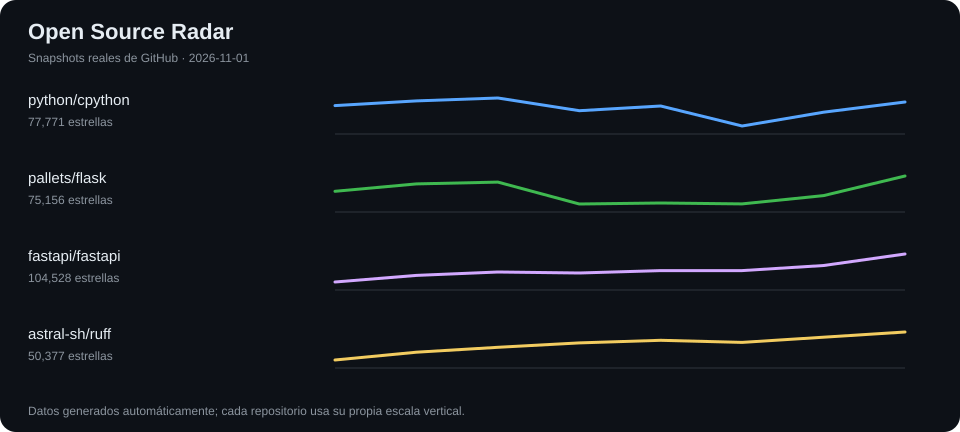

# GitHub Activity Lab · Open Source Radar

Monitorización de repositorios open source con Python, GitHub REST API y GitHub Actions.

## ¿Qué hace?

Cada día, sobre las **08:23 hora de Madrid** (ejecución programada, no garantizada al minuto):

1. Consulta la API pública de GitHub para varios repositorios incluidos en [`config/repos.json`](config/repos.json).
2. Valida estrellas, forks e incidencias/PRs abiertos.
3. Añade **una observación real por día UTC** a `data/history.csv`.
4. Actualiza `reports/latest.json`, `reports/summary.md`, `reports/stars.svg` y `reports/deltas.json`.
5. Publica entre **1 y 5 commits automáticos** según la fecha y los archivos que realmente hayan cambiado. Si no hay cambios, no publica ninguno.

## Resultados

- [Informe automático más reciente](reports/summary.md)
- [Datos JSON](reports/latest.json)
- [Variaciones frente al snapshot anterior](reports/deltas.json)
- [Histórico CSV](data/history.csv)



*Antes de la primera ejecución, los archivos de resultados estarán vacíos o aún no existirán.*

## Actualizaciones automáticas

**Este repositorio usa commits programados y automáticos. No representan programación manual diaria.**

Los commits `data(auto): ... [automated]` identifican datos generados por GitHub Actions. Su **committer** es siempre `github-actions[bot]`. De forma opcional, `AUTO_AUTHOR_NAME` y `AUTO_AUTHOR_EMAIL` pueden identificar al responsable de la automatización como autor Git. Esa atribución no implica programación manual ese día.

No se reescribe el histórico, no se crean commits vacíos y no se fabrican datos de métricas.

## Empezar

**Requisitos:** Python 3.13 para ejecución local; una cuenta de GitHub para programarlo. No hay dependencias de terceros.

```bash
python -m unittest discover -s tests -v
python src/monitor.py
```

El script consulta datos reales y crea automáticamente los archivos de resultados. Puedes editar la lista de repositorios en `config/repos.json`. Se admite un snapshot por fecha UTC; ejecutar dos veces el mismo día no genera otra actualización.

### Publicación en GitHub

1. Crea un **nuevo repositorio público, que no sea un fork**, llamado `github-activity-lab` y sube estos archivos a su rama por defecto (por ejemplo `main`).
2. Verifica que GitHub Actions esté permitido y que el repositorio acepte escritura con `GITHUB_TOKEN` desde el workflow (`permissions: contents: write`).
3. Abre **Actions > Open source daily snapshot > Run workflow** para ejecutar una primera vez.
4. Comprueba que se han creado los cinco archivos de datos e informes, que los commits describen actualizaciones automáticas y que la siguiente ejecución está programada.

`GITHUB_TOKEN` lo entrega GitHub automáticamente a cada ejecución: **no necesitas crear ni guardar un PAT** para este proyecto.

### Autor de las actualizaciones

Por defecto, el autor y el committer Git son el bot. Si se quiere identificar al responsable de la automatización, se pueden configurar `AUTO_AUTHOR_NAME` y `AUTO_AUTHOR_EMAIL` en **Settings > Secrets and variables > Actions > Variables**. Deben configurarse ambas o ninguna. El committer sigue siendo el bot y los mensajes conservan la marca `[automated]`.

### Publicación de los informes

El número objetivo de commits es `1 + ordinal(fecha UTC) % 5`. Los cinco archivos generados son unidades independientes; solo se incluyen los que realmente cambian. Se distribuyen entre hasta ese número de commits, sin crear commits vacíos. Tras crear los commits localmente, el workflow hace un único `push`. Si falla la generación, una prueba o un commit, la rama remota no recibe una publicación parcial. Si la rama remota ha avanzado, el workflow falla y una nueva ejecución recalcula el snapshot sobre la rama actual. Un segundo lanzamiento el mismo día UTC no añade otro snapshot.

## Límites y fallos conocidos

- Las ejecuciones programadas pueden retrasarse o perderse con alta carga de GitHub; también pueden deshabilitarse tras 60 días sin actividad en un repositorio público.
- Los resultados proceden de la API de GitHub y pueden cambiar con el tiempo. `open_issues_count` incluye pull requests.
- Si falla una consulta, el script finaliza con error **antes de publicar resultados incompletos**.
- En un segundo lanzamiento el mismo día UTC se omite el snapshot, aunque las cifras hayan variado; se conserva una observación diaria por repositorio.
- `GITHUB_TOKEN` no dispara normalmente otro workflow `push` al publicar; por eso el workflow diario ejecuta sus propias pruebas.

## Próximas mejoras legítimas

- Añadir pruebas para límites de tasa y esquemas de respuesta.
- Construir un dashboard en GitHub Pages.
- Incorporar detección de cambios destacados y release notes.
- Añadir un informe semanal y alertas de fallos.

## Fuentes

- [GitHub: scheduled workflow events](https://docs.github.com/en/actions/reference/workflows-and-actions/events-that-trigger-workflows)
- [GitHub: GITHUB_TOKEN](https://docs.github.com/en/actions/concepts/security/github_token)
- [GitHub: REST API rate limits](https://docs.github.com/en/rest/using-the-rest-api/rate-limits-for-the-rest-api)
