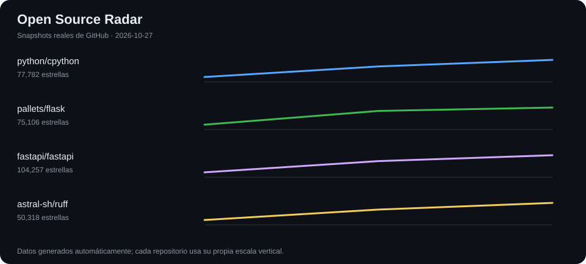

# GitHub Activity Lab · Open Source Radar

> Proyecto de portfolio: monitorización de repositorios open source con Python, GitHub REST API y GitHub Actions.

## ¿Qué hace?

Cada día, sobre las **08:23 hora de Madrid** (ejecución programada, no garantizada al minuto):

1. Consulta la API pública de GitHub para varios repositorios incluidos en [`config/repos.json`](config/repos.json).
2. Valida estrellas, forks e incidencias/PRs abiertos.
3. Añade **una observación real por día UTC** a `data/history.csv`.
4. Actualiza `reports/latest.json`, `reports/summary.md` y `reports/stars.svg`.
5. Publica **un único commit**, solo cuando los archivos han cambiado; sin commits vacíos ni datos ficticios.

## Resultados

- [Informe automático más reciente](reports/summary.md)
- [Datos JSON](reports/latest.json)
- [Histórico CSV](data/history.csv)



*Antes de la primera ejecución, los archivos de resultados estarán vacíos o aún no existirán.*

## Transparencia sobre la actividad

**Este repositorio usa commits programados y automáticos. No representan programación manual diaria.**

Los commits `data(auto): ... [automated]` indican explícitamente que son datos generados por GitHub Actions. Su **committer** es siempre `github-actions[bot]`. De forma **opcional**, el autor Git de dichos commits puede ser la cuenta que desarrolló/mantiene el sistema, configurando `AUTO_AUTHOR_NAME` y `AUTO_AUTHOR_EMAIL`. Esa atribución identifica el mantenimiento del proyecto, **no implica que el autor tecleara código ese día**. Los cambios humanos se publican en commits separados con mensajes como `feat:`, `fix:`, `test:` o `docs:`.

No se reescribe el histórico, no se crean commits vacíos y no se fabrican datos de métricas.

## Empezar

**Requisitos:** Python 3.13 para ejecución local; una cuenta de GitHub para programarlo. No hay dependencias de terceros.

```bash
python -m unittest discover -s tests -v
python src/monitor.py
```

El script consulta datos reales y crea automáticamente los archivos de resultados. Puedes editar la lista de repositorios en `config/repos.json`. Se admite un snapshot por fecha UTC; ejecutar dos veces el mismo día no genera otra actualización.

### Publicación en GitHub

1. Crea un **nuevo repositorio público, que no sea un fork**, llamado `github-activity-lab` y sube estos archivos a su rama por defecto (por ejemplo `main`).
2. Verifica que GitHub Actions esté permitido y que el repositorio acepte escritura con `GITHUB_TOKEN` desde el workflow (`permissions: contents: write`).
3. Abre **Actions > Open source daily snapshot > Run workflow** para ejecutar una primera vez.
4. Comprueba que se han creado los cuatro archivos de datos, que el commit describe una actualización automática y que la siguiente ejecución está programada.

`GITHUB_TOKEN` lo entrega GitHub automáticamente a cada ejecución: **no necesitas crear ni guardar un PAT** para este proyecto.

### Opcional: que el snapshot pueda contar en tu gráfico personal

Por defecto el autor Git es el bot, con lo que no se atribuirán a tu usuario los commits programados.

Si quieres una atribución transparente al mantenedor de la automatización, configura en **Settings > Secrets and variables > Actions > Variables** estas dos variables del repositorio:

- `AUTO_AUTHOR_NAME`: tu nombre de usuario de GitHub (p. ej., `miusuario`).
- `AUTO_AUTHOR_EMAIL`: la dirección `noreply` **exacta** de tu propia cuenta, visible en **Settings > Emails** de GitHub.

El workflow establece al bot como *committer* y al mantenedor como *author*. Los commits automatizados siguen claramente marcados. **GitHub puede contar estos commits** si se cumplen sus requisitos de atribución (correo vinculado, rama predeterminada, repositorio no fork y relación con el repositorio). El gráfico puede tardar en actualizarse; no se garantizan contribuciones todos los días.

No configures el correo o la identidad de ninguna otra persona. Si prefieres que solo se atribuya al bot, no configures las variables.

## Límites y fallos conocidos

- Las ejecuciones programadas pueden retrasarse o perderse con alta carga de GitHub; también pueden deshabilitarse tras 60 días sin actividad en un repositorio público.
- Los resultados proceden de la API de GitHub y pueden cambiar con el tiempo. `open_issues_count` incluye pull requests.
- Si falla una consulta, el script finaliza con error **antes de publicar resultados incompletos**.
- GitHub Actions **no garantiza** que cada ejecución compute como contribución de perfil.
- En un segundo lanzamiento el mismo día UTC se omite el snapshot, aunque las cifras hayan variado; es una decisión de diseño para evitar actividad repetitiva artificial.
- `GITHUB_TOKEN` no dispara normalmente otro workflow `push` al publicar; por eso el workflow diario ejecuta sus propias pruebas.

## Próximas mejoras legítimas

- Añadir pruebas para límites de tasa y esquemas de respuesta.
- Construir un dashboard en GitHub Pages.
- Incorporar detección de cambios destacados y release notes.
- Añadir un informe semanal y alertas de fallos sin inflar el número de commits.

## Fuentes

- [GitHub: profile contributions reference](https://docs.github.com/en/account-and-profile/reference/profile-contributions-reference)
- [GitHub: scheduled workflow events](https://docs.github.com/en/actions/reference/workflows-and-actions/events-that-trigger-workflows)
- [GitHub: GITHUB_TOKEN](https://docs.github.com/en/actions/concepts/security/github_token)
- [GitHub: REST API rate limits](https://docs.github.com/en/rest/using-the-rest-api/rate-limits-for-the-rest-api)
